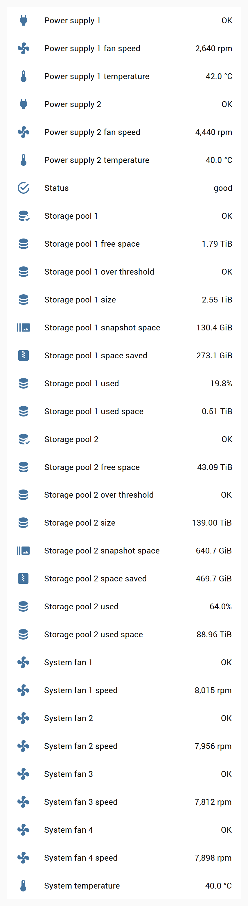

# QNAP for Home Assistant — with QuTS hero support

A drop-in replacement for Home Assistant's built-in [QNAP integration](https://www.home-assistant.io/integrations/qnap/). It keeps the same `qnap` domain and entities and adds what the core integration can't see on QuTS hero (ZFS) models:

- **Storage pools:** size, used, free, % used (with QNAP's alert threshold), snapshot space, and space saved by compression and dedup. There are also *problem* and *over threshold* binary sensors.
- **Fans:** the speed of each system fan, with a *problem* binary sensor for each.
- **Power supplies:** temperature, fan speed and a *problem* binary sensor for each redundant PSU.
- **Correct volume usage on ZFS.** A thin ZFS shared folder reports free space against its quota, not against what the pool actually has left. Core can report 150 TB free on a pool with 47 TB free. Here, volume free space is capped at the pool's free space, so % used is real.

It also fixes bugs that affect every model:

| Bug in core / qnapstats 0.4.0 | Effect | Fix here |
|---|---|---|
| The session-expiry retry discards its own result | One failed poll every time the NAS session expires | Retry result is returned |
| No request timeout is ever stored | A hung NAS blocks a Home Assistant worker thread indefinitely | 20 s default |
| A wrong password raises `TypeError` | Misleading errors, crashes on re-login | Raised as an authentication error |
| A missing system temperature or a partial NIC entry raises `KeyError` | The integration fails to load (qnapstats #108, #110) | Missing values become unknown |
| Every volume's size sensor is called "Volume size" | Colliding entity IDs (`_2`, `_3`, …) | Named per volume |

Tested against a TS-h1887XU-RP on QuTS hero h5.2.10 with Home Assistant 2026.10. QTS (non-ZFS) models should behave like core: there are no storage pools to report there, so you just get no pool sensors.

## Install

**HACS:** add this repository as a custom repository (category *Integration*), install **QNAP**, then restart Home Assistant. Home Assistant prefers a custom integration over a built-in one with the same domain. It logs a warning saying so, which is expected.

**Manual:** copy `custom_components/qnap` into your `config/custom_components/` and restart.

Then add the integration from *Settings → Devices & services*. If you already use the core QNAP integration, your existing entry and entities carry over unchanged. The new entities appear alongside them.

## The account

Use a dedicated account rather than your own admin login:

- QNAP's API serves system information only to administrators, or to an account with **Delegated Administration → System Monitoring** (Control Panel → Users). The delegated role is the least privilege that works.
- Turn off two-step verification for that account. The API login can't answer it.
- Log into the web UI as that account once, to clear any first-login wizards or agreements.

Polling is once a minute, about seven requests, taking a few seconds in total.

## Entities

Everything is grouped under one device per NAS. Most sensors are diagnostic. Volume and drive details that core disables by default stay disabled; enable what you want to keep.

| Group | Sensors | Binary sensors |
|---|---|---|
| System | status, system and CPU temperature, CPU and memory usage, uptime | — |
| Fans | System fan *n* speed (rpm) | System fan *n* (problem) |
| Power supplies | Power supply *n* temperature, fan speed | Power supply *n* (problem) |
| Storage pools | size, used space, free space, % used, snapshot space, space saved | Storage pool *n* (problem), over threshold |
| Volumes | size, used, free, % used (attribute: its storage pool) | — |
| Drives | status, temperature | — |
| Network | link, upload, download, errors, max speed | — |

Running on a TS-h1887XU-RP with QuTS hero h5.2.10:



## Development

The API client lives in `custom_components/qnap/api.py`. It subclasses `qnapstats` so each change can go upstream as its own pull request. Tests replay sanitised responses from a real NAS (`tests/fixtures/`):

```sh
pip install -r requirements_test.txt
pytest
```

The Home Assistant tests need Linux or macOS. Home Assistant's test harness doesn't run on Windows. `tests/test_api.py` runs anywhere with just `qnapstats` and `pytest`.

## Credits and licence

Based on the QNAP integration in [Home Assistant core](https://github.com/home-assistant/core/tree/dev/homeassistant/components/qnap) (Apache 2.0, by the Home Assistant authors and @disforw), using [python-qnapstats](https://github.com/colinodell/python-qnapstats) by Colin O'Dell. Licensed under Apache 2.0; see `LICENSE.md`.
